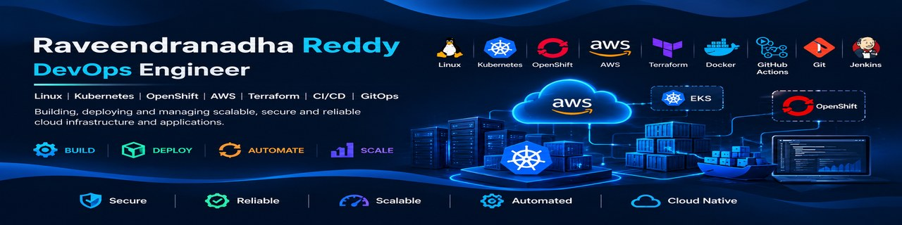

  

<h1 align="center">Hi, I'm Raveendranadha Reddy </h1>

<h3 align="center"> Linux | Kubernetes | OpenShift(ROSA) | AWS|Terraform| DevOps Engineer </h3>

  IT Professional with 7+ years of experience in Linux administration and hands-on experience in Kubernetes, OpenShift, AWS and DevOps tools.

---

## 🛠️ Technical Skills

  

## 🚀 Featured Projects

### 1. AWS EKS Platform
Kubernetes application deployment and cloud infrastructure on AWS.

Technologies: AWS, EKS, Kubernetes, Docker, Terraform

[View Repository](https://github.com/REDDYRN26/AWS-EKS)

### 2. Kubernetes CKA Labs
Hands-on Kubernetes administration, YAML practice and troubleshooting.

Technologies: Kubernetes, Linux, YAML, kubectl

[View Repository](https://github.com/Raveendranadha-Reddy/CKA)

### 3. Red Hat Linux Administration
Linux administration commands, configuration and troubleshooting practice.

Technologies: Linux, RHEL, Bash

[View Repository](https://github.com/Raveendranadha-Reddy/Redhat-Linux)

---

## ☁️ Areas of Expertise

- Linux Administration and Troubleshooting
- Kubernetes Administration
- AWS EKS and Cloud Infrastructure
- OpenShift Administration
- Docker and Containerization
- Terraform and Infrastructure as Code
- GitHub Actions and Jenkins CI/CD
- GitOps with Argo CD and Helm
- Bash Scripting

## 🏆 Certification

- Certified Kubernetes Administrator (CKA)

## 📊 GitHub Statistics

  

  

## 📈 Contribution Activity

  

## 🎯 Current Focus

- Advanced Kubernetes and EKS
- OpenShift and ROSA
- Terraform Infrastructure Automation
- CI/CD with GitHub Actions
- GitOps with Argo CD

---

  <b>BUILD • DEPLOY • AUTOMATE • SCALE</b>

  Thanks for visiting my GitHub profile!

